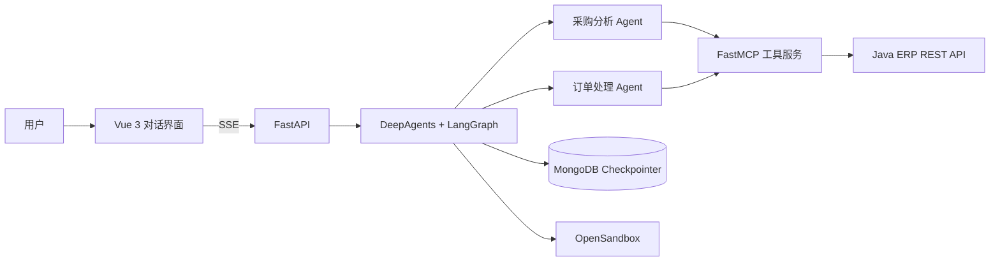

# ERP 采购智能助手

面向汽车零部件采购场景的 AI Agent 应用。用户以自然语言发起任务，助手查询供应商、配件和库存信息，分析采购需求，并可准备采购订单；遇到信息缺失或关键写操作时，会请求用户补充或确认。

## 功能

- **多 Agent 任务编排：** 使用 DeepAgents 与 LangGraph 构建主 Agent，并按采购分析、订单处理拆分子 Agent。
- **ERP 工具调用：** 通过 FastMCP 提供供应商、配件、库存、订单等 MCP 工具，连接 Java ERP REST API。
- **中断与恢复：** 对订单信息补全和关键操作设置 Human-in-the-Loop；MongoDB Checkpointer 保存对话状态，支持中断后继续。
- **隔离执行：** 通过 OpenSandbox 执行 Agent 的代码及分析任务，并管理相关文件。
- **对话界面：** Vue 3 前端通过 FastAPI 流式接收回答和工具调用事件，支持历史会话、停止生成和中断恢复。
- **上下文管理：** 提供用户偏好记忆、技能加载和上下文摘要中间件。当前用户偏好 Store 使用 InMemoryStore，适用于开发验证。

## 架构



## 技术栈

Python、DeepAgents、LangGraph、LangChain、FastMCP、MCP、FastAPI、Vue 3、MongoDB、OpenSandbox。

## 代码结构

- `src/agent/`：主 Agent、子 Agent 配置、记忆与中间件。
- `src/mcp_server/`：FastMCP 服务及供应商、配件、库存、订单工具。
- `src/api_view/`：对话与历史记录 API。
- `frontend/`：Vue 3 聊天界面。
- `tests/`：Python 和前端回归测试。
- `scripts/verify.ps1`：统一验证脚本。

## 本地验证

在项目根目录运行：

```powershell
pwsh -NoProfile -ExecutionPolicy Bypass -File .\scripts\verify.ps1
```

首次运行会通过 `uv` 和 `npm ci` 准备缺少的依赖，然后执行 Python 测试、编译检查、前端测试和生产构建。验证过程会禁用 `.env` 自动加载，也不会连接 MongoDB、ERP API 或 OpenSandbox，因此该脚本用于本地代码回归验证。

完整联调还需要配置模型 API 凭据、MongoDB，并启动可访问的 Java ERP API 与 OpenSandbox 服务。
